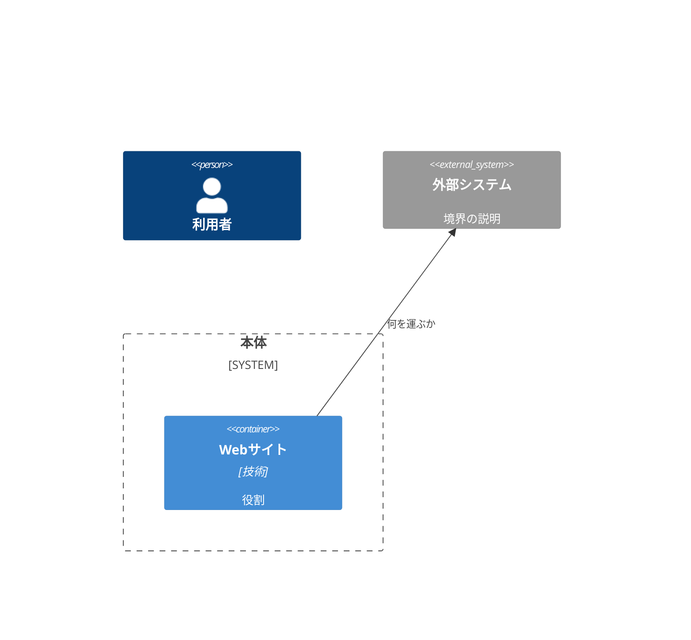

# generate-diagram — 図のオンデマンド生成

正本はコードであり、図は**コードから導出する**（[docs/adr/0001-source-of-truth.md](../../../docs/adr/0001-source-of-truth.md)）。図はファイルとして**コミットしない**（腐るため。例外は README の全体構成図 1 組だけ。[ADR 0009](../../../docs/adr/0009-readme-architecture-diagram-exception.md)）。見たいときに毎回生成する。出力は `work/`（gitignore）かスクラッチに置き、Mermaid なら本文に出して描画させる。

## 何を出すか（用途で選ぶ）

| 図 | 抽出法 | 使いどころ |
| --- | --- | --- |
| **依存グラフ / Component** | **静的（一次）** | モジュール間の依存・循環参照を機械的に見たい |
| **上位の構成図（Container/Context 相当）** | 静的を土台に**意味づけはモデル**（フォールバック） | プロセス境界・外部システムとの関係を俯瞰したい |
| **AWS構成図**（アカウント・OU・リージョン・AWSの資源） | `aws-architecture-diagram` スキルに渡す | AWSのどこに何があり、何をIaCが管理しているかを見たい |

静的で出せるものは静的で出す。意味づけ（「これはフロントエンド本体」「これは外部API」等の箱の役割）が要る上位の図だけ、コードを読んでモデルが構成する。

## 1. 静的抽出（一次・まずこれを試す）

リポの構成を見て対象を決める（本体パッケージ・フロント `src` 等）。利用可能なツールで依存グラフを取り、無ければ最小スクリプトで代替する。

### TypeScript / JavaScript

- `npx madge --json <対象ディレクトリ>`（JSON）か `npx madge --image work/deps.svg <対象ディレクトリ>`。`--circular` で循環検出。
- madge が使えない環境では import 文を grep して辺を起こす。

## 2. 上位の構成図（意味づけが要るとき・フォールバック）

静的グラフだけでは「箱の役割」と「外部システム」が出ない。次の手順でモデルが構成する。

1. 1 の静的結果と、エントリポイント（`index.*`・`main.*`・`package.json` scripts 等）・外部 I/O 境界（外部API・CMS・ホスティング・ファイルI/O）を読む。
2. Mermaid の C4（`C4Context` / `C4Container`）で、System・Container・外部 System を起こし、関係に「何を運ぶか」を1語添える。
3. 箱の対応（どのコード単位がどの Container か）を図の下に1行ずつ明記し、コードから辿れるようにする。

## 3. 出力の扱い

- **コミットしない**（README の全体構成図 1 組は例外。ADR 0009）。SVG/PNG は `work/`（gitignore）へ。Mermaid は本文に出して描画させる。
- 図が静的に出しにくい（依存がスパゲッティで読めない等）なら、それは設計が腐っている兆候として報告する（図化スクリプトの問題に矮小化しない）。
- 生成に使った一時スクリプトは `work/` に置く。
