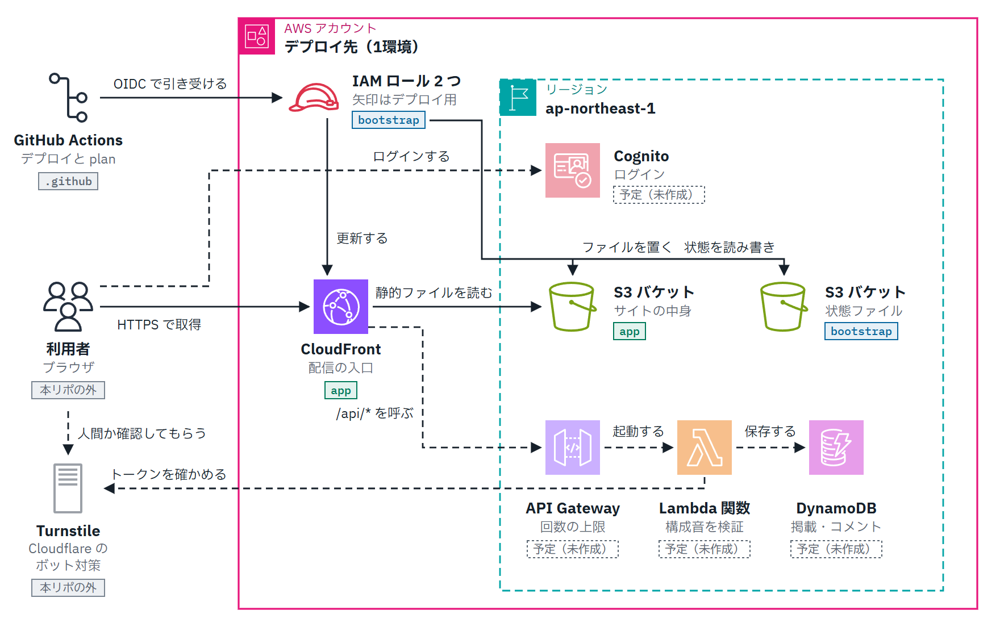

# shirabe-chord

コード進行を入れると、ギターの押さえ方の並び（手の移動が少なく弾きやすいもの）を出すサイト。ギターを弾かない作曲者が、ギター担当に渡す譜面を作る助けにする。

<picture>
  <source media="(prefers-color-scheme: dark)" srcset="docs/images/architecture-dark.png">
  
</picture>

2026-11-03 時点の予定の構成図（アイコンは [AWS Architecture Icons](https://aws.amazon.com/architecture/icons/)）。`bootstrap` のバッジはコードがあるもの、ほかは未作成で、実装が進むと食い違う。

次の 3 つのモードを、番号順に作る（[docs/adr/0006](docs/adr/0006-product-scope-and-stages.md)）。

1. 自由にコード進行を入れて、出力を得る（ログイン不要）。
2. 出力を、各コードの押さえ方の候補から選び直して微調整する。
3. 出力を恒久的に掲載し、コメントを残せる（書き込みはログイン必須）。

状態: モード 1 が手元で動く（配信はまだ。AWS のコードは `infra/bootstrap` の Terraform のみ）。

手元で動かす（Node.js 24 系と pnpm が要る。版は `package.json` の `packageManager`）:

```
pnpm install
pnpm --filter web dev
```

表示された URL（通常は http://localhost:5173/ ）をブラウザで開く。静的ファイルにするには `pnpm --filter web build`（`apps/web/dist` にできる）。画面は [docs/adr/0019](docs/adr/0019-web-screen-with-vite-and-react.md)。

## 構成（予定）

モード 1・2 は静的サイトで、コード理論と最適化はブラウザの中で動かす。上の図の理由は [docs/adr/](docs/adr/)（実装は TypeScript で [ADR 0007](docs/adr/0007-typescript-shared-core.md)、IaC は Terraform で [infra/](infra/README.md)、Organizations に依存しない [ADR 0003](docs/adr/0003-account-agnostic.md)）。

## 開発フロー

- 作業ガイドは [CLAUDE.md](CLAUDE.md) を参照。
- 設計判断（Why / Why not）は [docs/adr/](docs/adr/) に記録する。
- タスクは GitHub Issue で管理する（`.claude/skills/create-issue` → `.claude/skills/work-issue`）。

## コミット前の検査

このリポジトリは公開する前提で扱う（[docs/adr/0004](docs/adr/0004-treat-as-public-from-day-one.md)）。コミットのたびに、`private/` のファイルがステージされていないか、禁止語や秘密情報・個人情報の形が含まれていないかを検査する（[.githooks/](.githooks/)）。push の前には、送るコミットすべて（メッセージ・作者とコミッター・パス名と中身・ブランチ名とタグ名）を検査する（[docs/adr/0011](docs/adr/0011-scan-before-push-and-whole-history.md)）。作者とコミッターは、メールが `<ユーザー名>@users.noreply.github.com` で、名前がそのユーザー名であること。clone したら最初に入れる。

1. git 2.31 以上、Python 3.9 以上（検査フックの前提）、[gitleaks](https://github.com/gitleaks/gitleaks) を入れる（Windows なら `winget install Gitleaks.Gitleaks`、macOS なら `brew install gitleaks`、Linux なら [リリース](https://github.com/gitleaks/gitleaks/releases)のバイナリを PATH に置く）。PATH に置けないときは、環境変数 `GITLEAKS` に実行ファイルを指定する。
2. `git config core.hooksPath .githooks` を実行する。
3. `private/denylist.txt` に禁止語を1行1語で書く（UTF-8。空行と `#` で始まる行は無視される。全角・半角と大文字・小文字の違いは吸収する）。このファイルが無いか空のときは、検査できないのでコミットを止める。worktree からコミットしても、メインの作業ツリーの `private/denylist.txt` を使う。別の場所に置くなら、環境変数 `SHIRABE_CHORD_DENYLIST` に指定する。

検査に引っかかったときは、ファイル名・行番号・ルール番号（禁止語リストの行番号か gitleaks のルールID）だけが出る。一致した語や、禁止語を含むファイル名は出さない（何番目のファイルかだけを出す）。伏せたファイルは本人が確かめる。

履歴全体を同じ基準で再照合するには `sh .githooks/scan-history` を流す（禁止語を足した後や、公開する前に。違反が無ければ終了コード 0）。

防げないもの（フックを入れていないクローン、GitHub の Web 画面での編集、1行ごとの部分一致では拾えない書き方、`core.hooksPath` が効かないブランチなど）は [.githooks/README.md](.githooks/README.md) と [ADR 0004](docs/adr/0004-treat-as-public-from-day-one.md) を参照。

検査そのもののテストは `python -m unittest discover -s .githooks` で流す。
